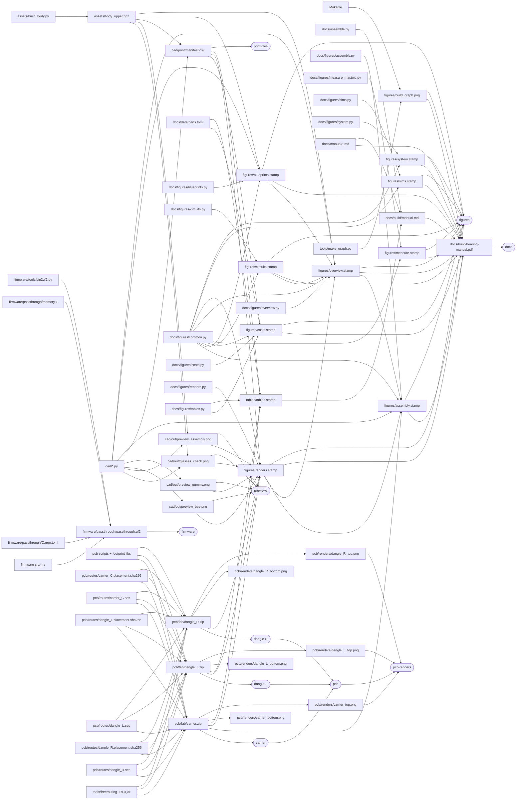

# Open-ear hearing aids (DIY, bone conduction)

Two do-it-yourself **open-ear hearing aids** for conductive hearing loss, designed entirely on screen from code. A microphone hangs from each earlobe inside a **gummy-bear earring**; a **XIAO nRF52840** in a **bumblebee necklace box** processes the sound for both ears; a vibrating **exciter** held against the bone behind each ear by a printed **spring arm clipped to your glasses** plays it back. Nothing goes in the ear canal.

> Hobby and learning project, **not a medical device**. Nothing here has been built, powered or tested on a person yet. See `docs` (the manual) for the status of every number.

What is in the repository:

- **CAD** (`cad/`): glasses-stem clips and spring arm, gummy-bear dangles, bee necklace box, all as parameterised [build123d](https://github.com/gumyr/build123d) scripts, plus a generator for the 58 print-ready STL files.
- **PCBs** (`pcb/`): two earring boards (left/right) and the necklace-box carrier, generated with KiCad's Python API, routed with Freerouting, checked with KiCad DRC, exported as JLCPCB-ready gerbers + BOM + CPL.
- **Firmware** (`firmware/`): a Rust (embassy-nrf) stereo PDM → I2S passthrough skeleton. Compile-only.
- **Manual** (`docs/`): a datasheet + user manual + project log with schematics, blueprints, simulations, print renders and IKEA-style assembly steps, generated as a PDF.

Everything that is not source is **generated by `make`** and ignored by git (except the small router locks in `pcb/routes/`, see below).

## Setup (macOS)

Prerequisites (install once):

```sh
brew install uv rustup openjdk@17 graphviz ngspice pandoc just   # `just` is optional; the Makefile is the interface
brew install --cask kicad              # KiCad 10: provides kicad-cli and the bundled Python with pcbnew
brew install --cask mactex-no-gui      # XeLaTeX for the PDF (or any TeX Live with xelatex, booktabs, fancyhdr, longtable)
rustup-init -y                         # then restart the shell so cargo is on PATH
```

You also need `java` on your `PATH` (OpenJDK 17: `brew info openjdk@17` shows the line to add) and the fonts *Helvetica Neue* and *Menlo* (standard on macOS).

Then, in the repository:

```sh
make setup        # uv sync, Rust target + llvm-tools, and every third-party download (make fetch)
make help         # list targets
make all          # build everything (about 10 minutes the first time)
```

`make fetch` downloads the third-party files listed in [`sources.toml`](sources.toml) (Freerouting 1.9.0, datasheets, the MakeHuman head-mesh sources) into places that are gitignored. If KiCad is installed somewhere else, set `KICAD_PY` (path to KiCad's Python 3) and `KICAD_FOOTPRINTS`.

## Make targets

| target | what it produces |
|---|---|
| `make help` | list the targets |
| `make all` | everything below except `reroute` |
| `make setup` | install Python deps, the Rust target, and run `fetch` |
| `make fetch` | download third-party files from `sources.toml` |
| `make previews` | software-rendered previews: whole assembly on the body (`cad/out/preview_assembly.png`), glasses close-up, bee, bears |
| `make print-files` | the 58 printable STLs and `manifest.csv` in `cad/print/` (all validity-checked) |
| `make dangle-L` / `dangle-R` / `carrier` | one PCB: gerbers + BOM + CPL zip in `pcb/fab/`, DRC report, KiCad 3D renders in `pcb/renders/` |
| `make pcb` | all three PCBs |
| `make pcb-renders` | the KiCad 3D renders of the three PCBs |
| `make reroute` | re-run Freerouting for all boards and rewrite the routing locks (then review and commit `pcb/routes/`) |
| `make firmware` | build the passthrough firmware: `.elf`, `.bin`, `.uf2` |
| `make figures` | every figure of the manual: circuit diagrams, system diagrams, blueprints, print-file renders, assembly steps, simulations, cost charts |
| `make docs` | the manual: `docs/build/hearing-manual.pdf` |
| `make graph` | redraw the dependency graph below (and `docs/build/figures/build_graph.png`) |
| `make check` | compile all Python, check the print files and that the DRC reports have no unconnected nets |
| `make clean` | delete everything generated (keeps downloads and the Python environment) |
| `make distclean` | also delete downloads and Rust build output |

Individual files are targets too, e.g. `make cad/out/preview_bee.png` or `make pcb/fab/carrier.zip`.

### Build dependency graph

<!-- BUILD-GRAPH:START -->

<!-- BUILD-GRAPH:END -->

## Reproducibility notes

- **Router results are committed.** KiCad's design export is not reproducible (random item IDs reorder it) and the autorouter's result depends on that order, so the accepted routing of each board is stored in `pcb/routes/<board>.ses` with a fingerprint of the placement it belongs to. `make pcb` re-uses the lock while the fingerprint matches and re-routes (and rewrites the lock) when the placement changes.
- Freerouting is run with `-dct 0`, which skips its "Start (20 s)" confirmation dialog.
- Figures, tables, the cost model and the BOM tables in the manual are all computed from the CAD, the PCB outputs and `docs/data/parts.toml`; change an input and `make docs` updates the PDF.

## Repository layout

```
Makefile  sources.toml  PLAN.md  CLAUDE.md
assets/    generic head mesh builder (CC0 sources are downloaded)
cad/       parts (params.py, glasses.py, earhook.py, gummy_dangle.py, bee_box.py), print_files.py, previews
pcb/       build_dangle.py, carrier/build_carrier.py, pipeline.py, finish*.py, routes/, lib/ (vendored footprints)
firmware/  passthrough/ (Rust), tools/bin2uf2.py
docs/      manual/ (chapters), figures/ (figure scripts), data/parts.toml
tools/     fetch.py, make_graph.py
```

`CLAUDE.md` explains the tools, conventions and gotchas for anyone (human or assistant) working in the repository; `PLAN.md` is the short current status.
